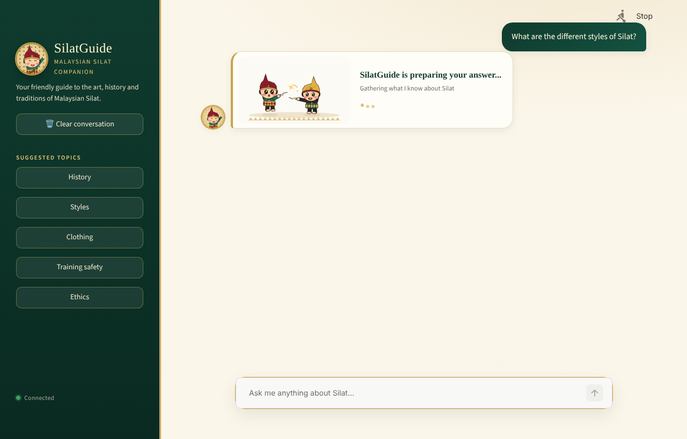
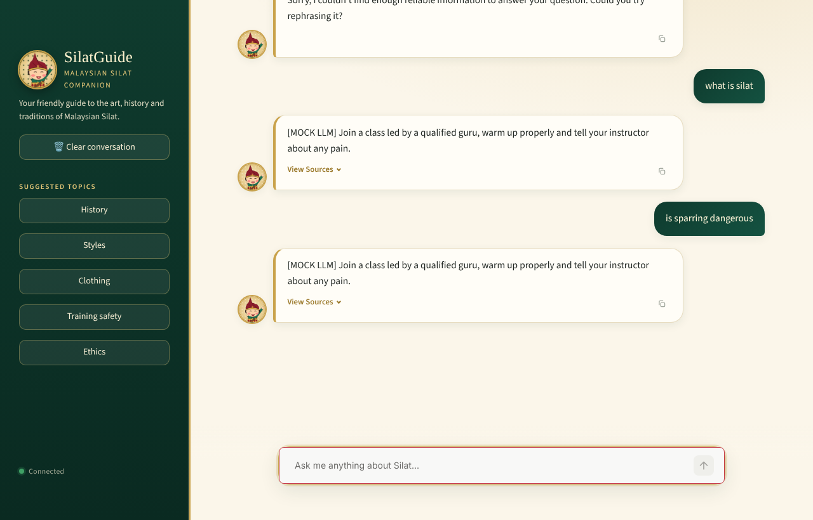

# 🥋 SilatGuide – A Local AI Chatbot for Malaysian Silat

**CSC649 Special Topics in Computer Science · Group Project (Domain: Malaysian Silat)**

SilatGuide is a beginner-friendly chatbot about **Malaysian Silat**. It answers in English using
**Retrieval-Augmented Generation (RAG)**: a custom 36-entry dataset is searched with
**TF-IDF + cosine similarity**, and **LLaMA 3.2 3B running locally through Ollama** turns the
retrieved facts into a natural answer. No API key, no subscription, no cloud.


> 🎬 **Demo video (2–4 min):** `TODO – add link here before submission`
> 📦 **Repository:** `TODO – csc649-groupNN-silatguide`

---

## 1. Team  *(TODO – fill in real details)*

| Member | GitHub username | Role | Main folders |
|---|---|---|---|
| TODO name | TODO | Project Leader | README, `docs/`, `tests/` |
| TODO name | TODO | Frontend Developer | `app/` |
| TODO name | TODO | Backend Developer / Model Integrator | `src/` |
| TODO name | TODO | Domain Specialist | `data/`, prompts, test cases |

GitHub evidence (Contributors graph, PR list, Project board) → add screenshots to `docs/`.

## 2. Problem statement
Beginners who want to learn about Silat find scattered, sometimes inaccurate or sensationalised
information, and general-purpose chatbots can "hallucinate" history, techniques and rules.
A trustworthy, safe, beginner-level source is needed that cites where facts come from.

## 3. Objectives
1. Build a domain-specific chatbot for Malaysian Silat (introduction, history, styles, culture, basic terms, safety, ethics, clothing).
2. Ground answers in a **custom, sourced dataset** instead of the model's memory.
3. Run **fully locally** (Ollama + LLaMA 3.2 3B) on a 16 GB laptop.
4. Refuse unrelated, unsafe or rule-bypassing requests and **admit when it does not know**.
5. Provide a polished, culturally themed interface and automated tests.

## 4. Technologies
Python 3.10+ · Streamlit · Ollama · LLaMA 3.2 3B (`llama3.2:3b`) · scikit-learn (TF-IDF, cosine) · pandas · requests · Pillow (artwork) · pytest.

## 5. AI model
| | |
|---|---|
| Model | `llama3.2:3b` (Meta LLaMA 3.2, 3 billion parameters, 4-bit quantised by Ollama, roughly 2 GB download) |
| Why | Small enough for a 16 GB laptop, follows instructions well, free and private, runs offline |
| Role | **Only rewrites retrieved facts** into friendly English. It is told to use *only* the supplied context. |
| Parameters | `temperature 0.1` (consistent answers), `num_ctx 2048`, `num_predict 220`, `top_p 0.9`, `repeat_penalty 1.1`, `keep_alive 10m` (all in `.env`) |

## 6. Dataset (exactly 36 Q&A pairs)
`data/silat_qa.csv` with columns `Question, Answer, Source, Category`.

| Category | # |
|---|---:|
| Introduction to Silat | 5 |
| History and Origins of Silat | 5 |
| Types and Styles of Silat | 4 |
| Malay Culture and Heritage | 4 |
| Basic Silat Movements and Techniques | 4 |
| Ethics and Discipline | 4 |
| Training Safety | 4 |
| Traditional Clothing and Equipment | 3 |
| General Beginner Questions | 3 |

**Sources** (UNESCO ICH entries for Silat, JWN, JKKN, a 2025 injury study, etc.) are listed with their
verification status in [`data/SOURCES.md`](data/SOURCES.md); collection method, preprocessing and
limitations are in [`data/DATASET_DESCRIPTION.md`](data/DATASET_DESCRIPTION.md).

> ⚠️ **Honest status:** the dataset was drafted with GenAI help. Three sources (the UNESCO Malaysia entry, the UNESCO
> Indonesia entry and the JWN Silat page) were read in full; most others were seen only as page excerpts. The group
> **must open every source, check every entry and edit where needed** (see the checklist in `SOURCES.md`).

## 7. RAG architecture

```
User question → Preprocessing → Dataset Retrieval → Relevant Context → LLaMA 3.2 via Ollama → Generated Answer → Streamlit Interface
```
Full diagram: [`docs/architecture.md`](docs/architecture.md).

### System workflow
1. **Safety/routing** (`src/utils.py`, `src/chatbot.py`): greetings get a canned reply; prompt-injection attempts and requests to hurt people are refused **before** retrieval – the LLM never sees them.
2. **Preprocessing**: lower-case, strip punctuation, expand chat slang, canonicalise variants (`recognized`→`recognition`), remove stop-words, stem, spell-correct unknown words against the dataset vocabulary (edit distance).
3. **Retrieval** (`src/retrieval.py`): TF-IDF word-grams + character n-grams; cosine similarity against question text, full entries and category names; top-3 returned with scores.
4. **Relevance check**: accepted only if the blended score ≥ `SIMILARITY_THRESHOLD` (default 0.25) **and** the IDF-weighted *coverage* of the question's words in the dataset vocabulary ≥ 0.60.
5. **Generation** (`src/llm.py`): relevant entries go into a strict system prompt; LLaMA 3.2 answers in 2–4 sentences.
6. **Display** (`app/main.py`): a clean chat bubble with a copy icon and a collapsible **View Sources** list (only the sources stored in the dataset). Technical details (model name, scores, timings) are not shown in chat.

### How low-relevance questions are handled
* *Off-topic* ("capital of France") → no word overlap → rejected → polite fallback message, **LLM not called**.
* *Silat-related but unanswerable* ("tuition fee at Silat schools", "scoring system") → the unknown words lower *coverage* → rejected → fallback.
* *Borderline* → if retrieval passes but the context doesn't contain the answer, the system prompt tells LLaMA to return the same fallback text.
* *Ollama unavailable* → the best dataset answer is shown with a short, friendly note ("the AI assistant is resting right now…") and the sidebar dot turns orange – it is never passed off as an LLM answer.

Fallback text: *"Sorry, I couldn't find enough reliable information to answer your question. Could you try rephrasing it?"*

## 8. Features
Cute **chibi guide avatar** (tengkolok, baju Melayu, songket samping) · **two-fighter sparring loading animation** with small keris props (harmless, no violence) · forest-green / gold / cream theme with songket and *pucuk rebung* motifs · chat bubbles with avatars · copy-answer icon · collapsible *View Sources* · subtle connection dot in the sidebar · four welcome questions and five sidebar topics (every one checked to be answerable) · clear-chat · responsive layout (sidebar collapses on phones).

| Loading animation | Out-of-scope reply |
|---|---|
|  |  |

Artwork is generated by code (`scripts/generate_assets.py`). **To use your own artwork,** replace `app/assets/chatbot_avatar.png` and `app/assets/loading_silat.gif` (same names) – no code changes needed.

## 9. Installation (Windows 10/11)

### a) Install Ollama and the model
1. Download and install **Ollama for Windows** from <https://ollama.com/download>.
2. Open **PowerShell** and run:
   ```powershell
   ollama pull llama3.2:3b
   ollama run llama3.2:3b "Say hello in one sentence"   # quick test, then type /bye
   ```
   The Ollama app runs in the system tray and serves `http://localhost:11434`.
   (Ollama uses your GPU if supported, otherwise the CPU. With 16 GB RAM the 3B model is comfortable; close heavy apps for faster replies.)

### b) Set up the project
```powershell
git clone <your-repo-url> SilatGuide
cd SilatGuide
python -m venv .venv
.venv\Scripts\activate
pip install -r requirements.txt
copy .env.example .env        # optional – defaults already work
```

## 10. Run the app
```powershell
streamlit run app/main.py
```
(or double-click `run_windows.bat`). Open <http://localhost:8501>. A small dot at the bottom of the sidebar shows **Connected** when Ollama and the model are ready.
If it shows *Offline*, the app still works but answers come straight from the dataset with a short note.

Regenerate artwork (optional): `python scripts/generate_assets.py`

## 11. Testing
```powershell
pytest -v                                  # fast tests, no Ollama needed
set RUN_OLLAMA_TESTS=1 && pytest -v -k live   # optional live test (Ollama running)
```
`tests/test_cases.csv` holds 37 labelled questions (exact, paraphrase, informal, misspelled, off-topic, insufficient-context, unsafe, injection); `tests/test_retrieval.py` also tests dataset integrity, routing, Ollama failure handling and the HTTP client.

### Test status – what was and wasn't actually run
| Check | Status |
|---|---|
| 69 pytest items: **67 passed, 1 skipped** (live Ollama test), **1 expected failure** (documented limitation) | ✅ **Executed** by the AI assistant in a Linux sandbox on 21 Nov 2026 |
| Streamlit `AppTest` smoke test (welcome → click suggestion → ask off-topic question) | ✅ Executed in the sandbox |
| Headless-browser screenshots of the real UI, including the loading animation against a **mock** Ollama server (5 s delay) | ✅ Executed in the sandbox |
| HTTP client behaviour against a **mocked** Ollama API | ✅ Executed (mock, not the real service) |
| Real **LLaMA 3.2 3B answers**, their quality, speed and memory use on the MSI Thin B12UC | ❌ **Not executed** – Ollama is not available in the sandbox. The group must test this. |
| Windows install instructions | ❌ Not executed |
| Group's own full test run + results table | ⬜ TODO – add your results below |

**Group results:** `TODO – date, machine, pytest output, 5+ real sample conversations (good and bad)`

**Tuning note:** the similarity threshold (0.25) and coverage gate (0.60) were chosen by the drafter on a
development set of about 70 questions, then checked on 37 labelled cases. On that first check 5 cases failed; the spell-corrector, a few synonyms
and one safety pattern were improved, and one paraphrase (T08) was reworded with the original kept as a
documented expected failure. Because the cases influenced the fixes, the results are optimistic: re-tune and
re-test with your own unseen questions.

## 12. Limitations
* Only 36 entries – many valid questions are (intentionally) unanswered.
* Retrieval is **lexical**: it cannot understand all paraphrases (e.g. "put on" ≠ "wear" – an expected-fail test documents this) and may match a loosely related entry (e.g. "who made Silat?" matches "What is Silat?"; the LLM prompt then has to decline).
* Safety/injection filters are keyword rules – they can be bypassed by creative phrasing and may rarely block a harmless question.
* A 3B model can still paraphrase imperfectly; the grounded prompt and low temperature reduce, but do not eliminate, errors. Always check the shown sources.
* Facts depend on the verification status in `data/SOURCES.md`.
* Dataset is English only; no conversation memory (each question is answered independently).
* The injury statistics come from one regional study of adolescents.
* SilatGuide gives **information only**, not training or medical advice.

## 13. Future improvements
Sentence-embedding retrieval · more verified entries (with an instructor's review) · Malay-language support · conversation memory · streaming answers · feedback buttons · evaluation with real learners.

## 14. Project structure
```
app/        main.py, styles.css, assets/ (avatar PNG, loading GIF)
src/        chatbot.py (RAG flow) · llm.py (Ollama) · retrieval.py (TF-IDF) · utils.py (settings, safety)
data/       silat_qa.csv · SOURCES.md · DATASET_DESCRIPTION.md
tests/      test_cases.csv · test_retrieval.py
scripts/    generate_assets.py
docs/       architecture.md, screenshots/, (slides, notes, GitHub evidence → TODO)
```

## 15. GitHub teamwork  *(TODO – genuine evidence only)*
Follow the CSC649 rules: issues + project board, branches + reviewed pull requests, ≥10 meaningful commits per member on ≥5 days in ≥3 weeks, own account, no secrets, make the repo **Public** on submission day, and add the lecturer (`tengkuzatul`) as collaborator by end of Week 6.
Suggested split: Leader → README/tests/docs · Frontend → `app/` · Backend → `src/` · Domain specialist → `data/` and test questions.
Please **do not commit this whole project in one batch**: each member should commit and explain their own part.

## 16. GenAI usage declaration  *(CSC649 Tahap 3 – Kolaborasi Hibrid)*
The initial project scaffold (code structure, Streamlit interface, retrieval and Ollama integration, tests, artwork generation script, dataset draft and documentation) was drafted with **Claude (Anthropic)** from the group's brief. Web sources were consulted by the assistant to draft the dataset; its verification status is recorded in `data/SOURCES.md`.
The group must: review, test and understand every file; verify the sources; make their own edits through their own commits; and complete the FSKM declaration at <https://kbg-pelajar-fskm.web.app>.
`TODO – each member adds a sentence on what they personally changed/wrote and how they used GenAI.`

## 17. Acknowledgements
UNESCO Intangible Cultural Heritage, Jabatan Warisan Negara Malaysia, JKKN, Meta (LLaMA 3.2), Ollama, Streamlit.
