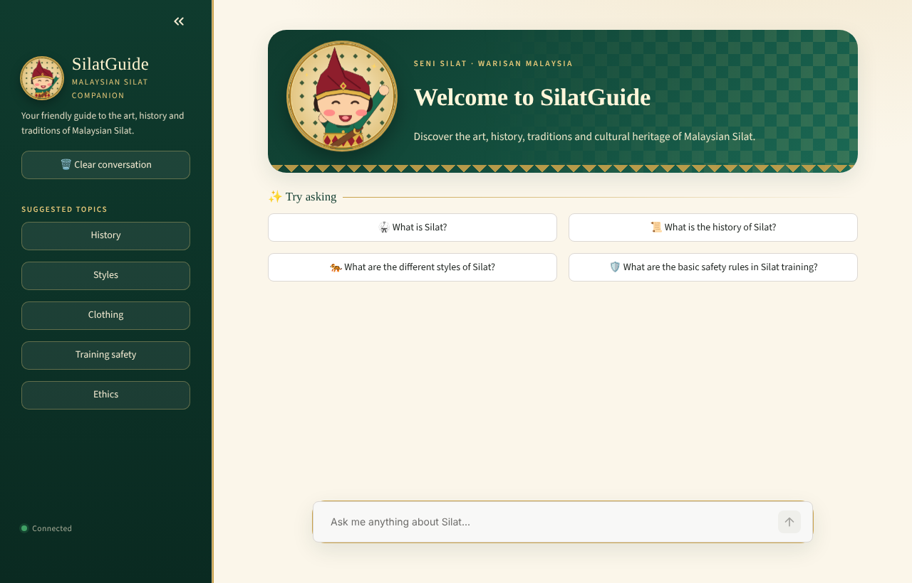

# 🥋 SilatGuide – A Local AI Chatbot for Malaysian Silat

**CSC649 Special Topics in Computer Science · Group Project (Domain: Malaysian Silat)**

SilatGuide is a beginner-friendly chatbot about **Malaysian Silat**. It answers in English using
**Retrieval-Augmented Generation (RAG)**: a custom 36-entry dataset is searched with
**TF-IDF + cosine similarity**, and **LLaMA 3.2 3B running locally through Ollama** turns the
retrieved facts into a natural answer. No API key, no subscription, no cloud.



> 🎬 **Demo video (2–4 min):** `add link here `
> 📦 **Repository:** `(https://github.com/airyy-cs/csc649-group03-silatguide)`

---

## 1. Team  

| Member | GitHub username | Role | Main folders |
|---|---|---|---|
| NURUL AQILAH ARISYA  | https://github.com/airyy-cs | Project Leader/ Backend Developer | README, `docs/`, `tests/` |`src/` |
| NADIA NUR FARAH | https://github.com/dinanazari | Frontend Developer | `app/` |`script/`
| HANI NUR ATHILAH | https://github.com/athilaharun-blip | Domain Specialist | `data/`, prompts, test cases |


## 2. Problem statement
Beginners who want to learn about Silat find scattered, sometimes inaccurate or sensationalised
information, and general-purpose chatbots can "hallucinate" history, techniques and rules.
A trustworthy, safe, beginner-level source is needed that cites where facts come from.

## 3. Objectives
1. Build a domain-specific chatbot for Malaysian Silat (introduction, history, styles, culture, basic terms, safety, ethics, clothing).
2. Ground answers in a **custom, sourced dataset** instead of the model's memory.
3. Run **fully locally** (Ollama + LLaMA 3.2 3B) on a 16 GB laptop.
4. Refuse unrelated, unsafe or rule-bypassing requests and **admit when it does not know**.
5. Provide a polished, culturally themed interface and automated tests.

## 4. Technologies
Python 3.10+ · Streamlit · Ollama · LLaMA 3.2 3B (`llama3.2:3b`) · scikit-learn (TF-IDF, cosine) · pandas · requests · Pillow (artwork) · pytest.

## 5. AI model
| | |
|---|---|
| Model | `llama3.2:3b` (Meta LLaMA 3.2, 3 billion parameters, 4-bit quantised by Ollama, roughly 2 GB download) |
| Why | Small enough for a 16 GB laptop, follows instructions well, free and private, runs offline |
| Role | **Only rewrites retrieved facts** into friendly English. It is told to use *only* the supplied context. |
| Parameters | `temperature 0.1` (consistent answers), `num_ctx 2048`, `num_predict 220`, `top_p 0.9`, `repeat_penalty 1.1`, `keep_alive 10m` (all in `.env`) |


## 6. Dataset (exactly 36 Q&A pairs)
`data/silat_qa.csv` with columns `Question, Answer, Source, Category`.

| Category | # |
|---|---:|
| Introduction to Silat | 5 |
| History and Origins of Silat | 5 |
| Types and Styles of Silat | 4 |
| Malay Culture and Heritage | 4 |
| Basic Silat Movements and Techniques | 4 |
| Ethics and Discipline | 4 |
| Training Safety | 4 |
| Traditional Clothing and Equipment | 3 |
| General Beginner Questions | 3 |

**Sources** (UNESCO ICH entries for Silat, JWN, JKKN, a 2025 injury study, etc.) are listed with their
verification status in [`data/SOURCES.md`](data/SOURCES.md); collection method, preprocessing and
limitations are in [`data/DATASET_DESCRIPTION.md`](data/DATASET_DESCRIPTION.md).

## 7. RAG architecture

```
User question → Preprocessing → Dataset Retrieval → Relevant Context → LLaMA 3.2 via Ollama → Generated Answer → Streamlit Interface
```
Full diagram: [`docs/architecture.md`](docs/architecture.md).

### System workflow
1. **Safety/routing** (`src/utils.py`, `src/chatbot.py`): greetings get a canned reply; prompt-injection attempts and requests to hurt people are refused **before** retrieval – the LLM never sees them.
2. **Preprocessing**: lower-case, strip punctuation, expand chat slang, canonicalise variants (`recognized`→`recognition`), remove stop-words, stem, spell-correct unknown words against the dataset vocabulary (edit distance).
3. **Retrieval** (`src/retrieval.py`): TF-IDF word-grams + character n-grams; cosine similarity against question text, full entries and category names; top-3 returned with scores.
4. **Relevance check**: accepted only if the blended score ≥ `SIMILARITY_THRESHOLD` (default 0.25) **and** the IDF-weighted *coverage* of the question's words in the dataset vocabulary ≥ 0.60.
5. **Generation** (`src/llm.py`): relevant entries go into a strict system prompt; LLaMA 3.2 answers in 2–4 sentences.
6. **Display** (`app/main.py`): a clean chat bubble with a copy icon and a collapsible **View Sources** list (only the sources stored in the dataset). Technical details (model name, scores, timings) are not shown in chat.

### How low-relevance questions are handled
* *Off-topic* ("capital of France") → no word overlap → rejected → polite fallback message, **LLM not called**.
* *Silat-related but unanswerable* ("tuition fee at Silat schools", "scoring system") → the unknown words lower *coverage* → rejected → fallback.
* *Borderline* → if retrieval passes but the context doesn't contain the answer, the system prompt tells LLaMA to return the same fallback text.
* *Ollama unavailable* → the best dataset answer is shown with a short, friendly note ("the AI assistant is resting right now…") and the sidebar dot turns orange – it is never passed off as an LLM answer.

Fallback text: *"Sorry, I couldn't find enough reliable information to answer your question. Could you try rephrasing it?"*

